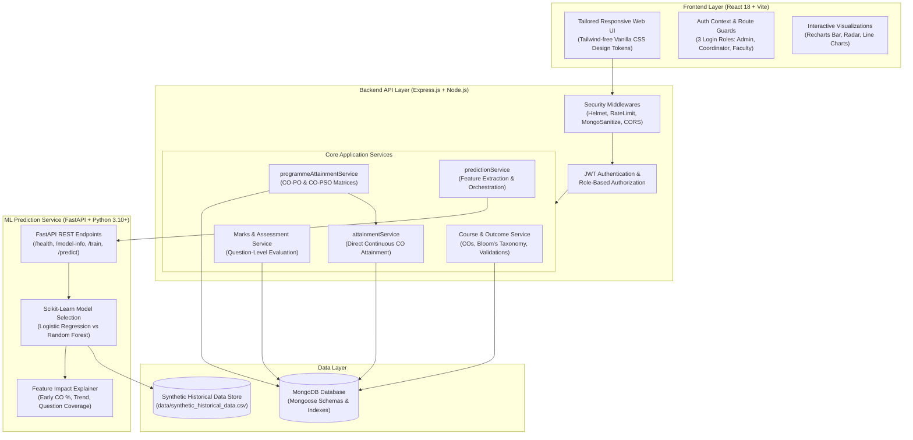
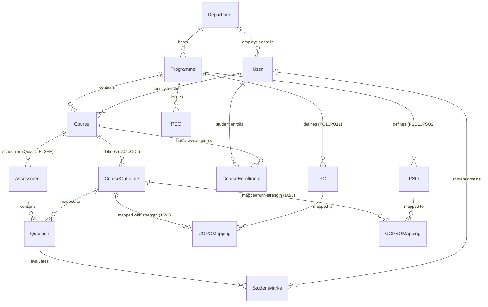
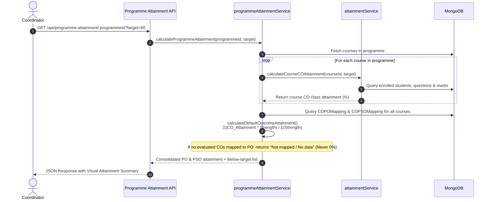

# OBE Platform Architecture & Technical Design

> **Version**: 1.0.0 (Phase 8 Stabilized)  
> **Target Environment**: Node.js 18+, MongoDB 6+, Python 3.10+, React 18+ (Vite)

---

## 1. System Architecture Diagram

---

## 2. Entity-Relationship (ER) Diagram

---

## 3. CO to PO / PSO Attainment Flow

The OBE attainment pipeline enforces strict architectural boundaries: `programmeAttainmentService` strictly reuses `attainmentService` and **never** re-computes raw marks or individual student CO attainment.

### PO / PSO Formula Definition & Isolation

In accordance with institutional accreditation guidelines, the weighted-average calculation is isolated in `programmeAttainmentService.js`:

$$\text{Attainment}(PO_j) = \frac{\sum_{i \in \text{Mapped COs}} \left( \text{Attainment}(CO_i) \times \text{Strength}_{ij} \right)}{\sum_{i \in \text{Mapped COs}} \text{Strength}_{ij}}$$

> [!IMPORTANT]
> **Formula Status**: Clearly labeled as an unconfirmed default formula in `calculateDefaultOutcomeAttainment()`. It can be swapped with direct rubric or direct-plus-indirect attainment formulas once verified by institutional leadership.
> When a PO/PSO has no mapped COs or no student marks recorded, it displays **`Not mapped / No data`** and is explicitly excluded from calculations (never defaulted to 0%).

---

## 4. Machine Learning Early Warning Layer

### Problem Statement
In traditional Outcome-Based Education workflows, attainment is calculated only after final semester examinations conclude, creating a delayed feedback loop where students cannot be remediated in time.

The ML Early Warning Layer continuously analyzes early assessments (quizzes, assignments, mid-semester internals) to predict whether each student is on track to attain each Course Outcome before the end-semester exam.

### Continuous Feature Representation
For each `(Student, CourseOutcome)` pair:
1. **`early_co_pct`**: Student's score percentage on continuous assessments specifically mapped to this CO (0% – 100%).
2. **`num_eval_questions`**: Number of evaluated questions mapped to this CO completed so far.
3. **`overall_early_pct`**: Overall average score across all early assessments to capture student baseline ability.
4. **`trend`**: Performance trajectory between earlier and later assessments (e.g., Midterm % minus Quiz %).

### Leak Prevention Guarantee
The system guarantees zero data leakage: end-semester (`end_sem`) examination questions and marks are strictly filtered out prior to feature extraction in `predictionService.js`.

### Model Evaluation & Selection
- **Algorithms**: Evaluates Logistic Regression (interpretable baseline) and Random Forest Classifier using 5-fold cross-validation.
- **Metric**: Selected automatically based on validation **F1-score** to balance precision and recall on at-risk students.
- **Model Storage**: Serialized using `joblib` into `ml-service/models/attainment_model.joblib`.
- **Explainability**: Every prediction generates individualized feature contributions (Positive/Negative impact) and specific institutional remediation recommendations.

---

## 5. Synthetic Historical Data Disclosure & Transition

### Disclosure
Current institutional installations utilize synthetic historical student data generated by `ml-service/app/synthetic_data.py` (1,500 training instances) stored at `ml-service/data/synthetic_historical_data.csv`. This data models realistic student ability distributions, topic-specific noise, and grade progressions.

### Transition to Real Data
Institutions can transition to real historical multi-year student data with **zero code changes**:
1. Export historical student assessment performance in the exact CSV schema (`early_co_pct, num_eval_questions, overall_early_pct, trend, attained_final`).
2. Overwrite `ml-service/data/synthetic_historical_data.csv`.
3. Call `POST /api/ml/train` (Admin endpoint) to retrain and evaluate the model on live institutional data.

---

## 6. Known Gaps & Future Enhancements

1. **PO / PSO Formula Finalization**: The current weighted-average calculation represents the NBA default guideline. Final institution-specific formula rules (e.g., 80% Direct CIE/SEE + 20% Indirect Exit Surveys) require formal curriculum committee sign-off.
2. **Batch Import for Historical Curricula**: Currently, courses and curricula can be seeded or imported per assessment. Bulk Excel upload for multi-year legacy data is planned.
3. **Student Records Role Boundary**: Platform access is strictly restricted to 3 login roles: Admin, Coordinator, and Faculty. Students do not log in and exist solely as data records (rollNo, name, department) essential for course enrollments, question marks, CO attainment, and continuous ML risk predictions.
